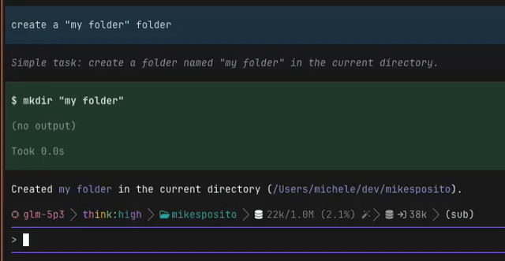

# pi-tags

[](https://www.npmjs.com/package/pi-tags)
[](LICENSE)

Tag points in a pi conversation, then find them again.

<p align="center">
	
</p>

A tag is a short label pinned to a message in the session. Tags are stored
as pi entry labels, so they persist in the session file, travel into forks,
and show up wherever pi shows labels: `/tree` lists them, `Shift+L` edits
them, and `Ctrl+L` filters the tree down to tagged entries only.

```
/tag refactor-auth     Tag the last message
/tag                   Tag it with a generated label (tag-1, tag-2, …)
alt+t                  Same, without leaving the keyboard
/untag                 Remove the tag from the last message
/tags                  List every tag on the active branch
/tagfork               The /fork picker, with tags shown inline
/checkout <tag>        Jump to a tagged entry, no branch summary
/tree                  Built-in: browse the session tree, every tag shown
                       on its entry (Shift+L edits, Ctrl+L filters to tagged)
```

`/tag` always tags the newest message of the active branch. To tag an
earlier point, navigate there with `/tree` first, then tag. `/checkout`
lands right after the tagged message (usually the reply it names) and,
with duplicate tag names, jumps to the most recent one.

## /tagfork

The built-in `/fork` picker lists user messages as plain text and cannot be
changed by an extension. `/tagfork` is the same picker built from the same
active branch, with each message's tag in brackets:

```
 1. [start] first prompt
 2. tried the naive parser, blew up on nested quotes
 3. [post-refactor] rerun the suite, all green
```

Pick one and pi forks from that message, exactly like `/fork`.

A tag shows on the row of the prompt it belongs to: `/tag` labels the
newest message, which is normally the assistant reply, so a row shows
either the tag on that user message or the tag on the reply that follows
it.

## Install

From npm:

```sh
pi install npm:pi-tags
```

Or from GitHub:

```sh
pi install git:github.com/mikesposito/pi-tags
```

Try it once without installing:

```sh
pi -e npm:pi-tags
```

For local development, symlink the checkout into your extensions directory,
or load it per run:

```sh
ln -s /path/to/pi-tags ~/.pi/agent/extensions/pi-tags
pi -e /path/to/pi-tags
```

No runtime dependencies, no configuration. The host-provided pi package is
declared as a peer.
